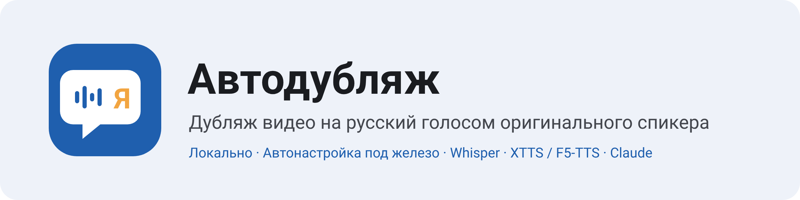
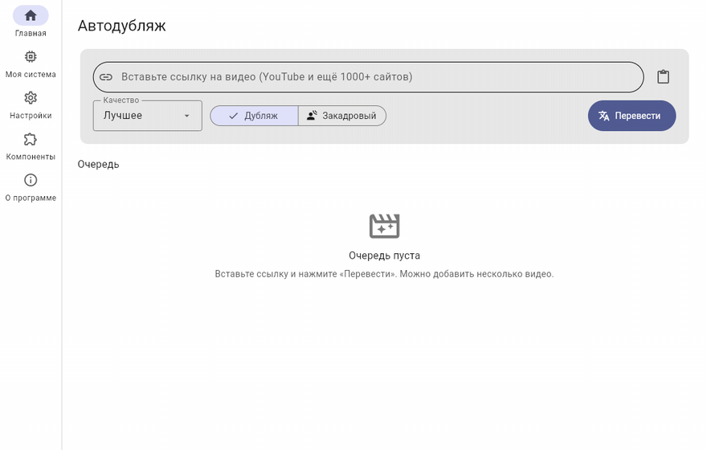
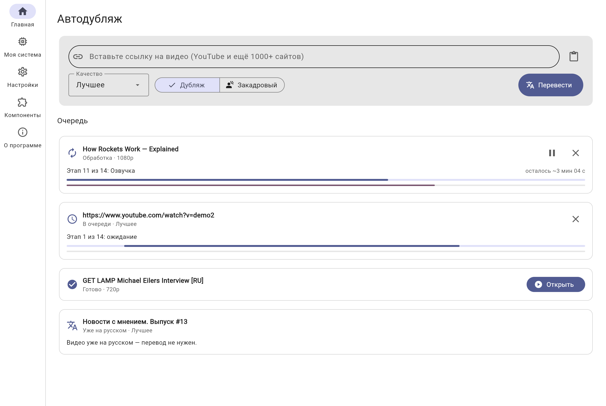
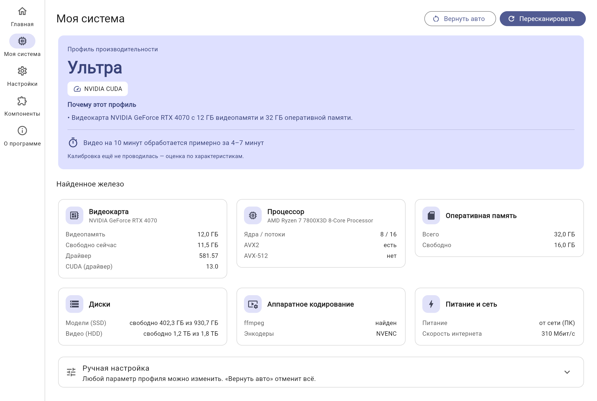
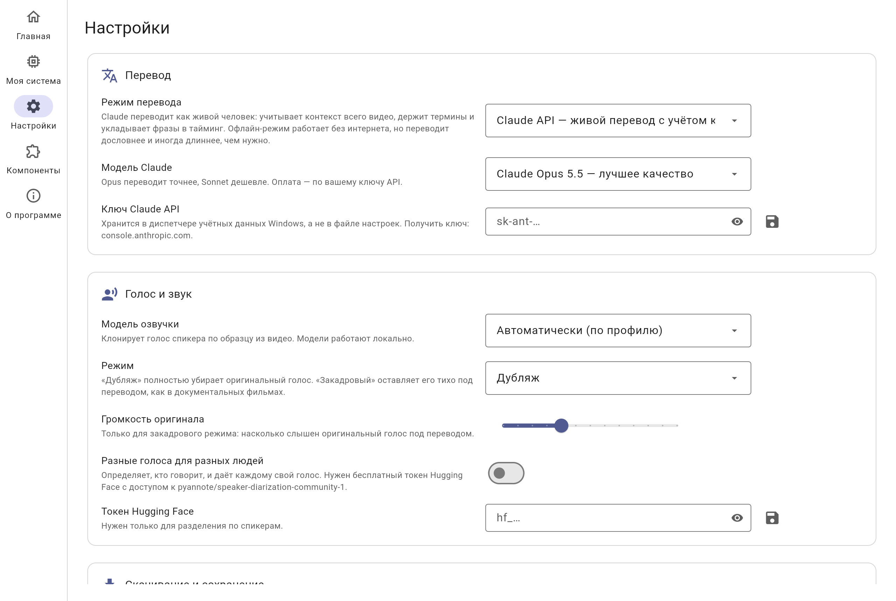
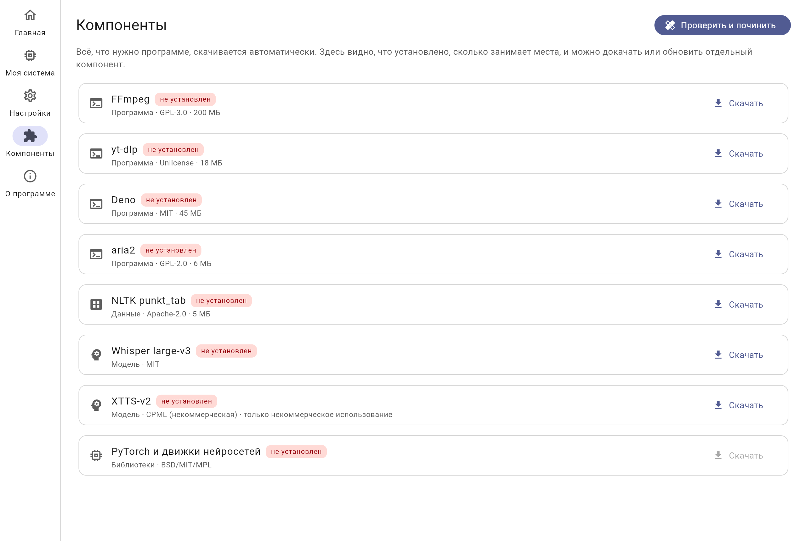
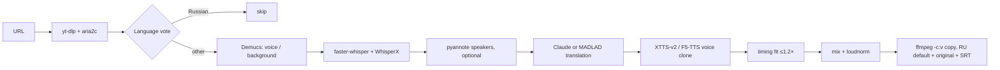

<p align="right"><a href="README.md">Русский</a> · <b>English</b></p>

<p align="center">
  
</p>

<p align="center">
  <a href="https://github.com/Zaxar1231/Yutr/releases/latest"></a>
  <a href="https://github.com/Zaxar1231/Yutr/releases"></a>
  <a href="https://github.com/Zaxar1231/Yutr/actions/workflows/ci.yml"></a>
  <a href="LICENSE"></a>
  
  
</p>

<p align="center"><b>Paste a video link and get it dubbed into Russian in the original speaker's voice.</b><br>
Everything runs on your PC and tunes itself to your hardware.</p>

<p align="center">
  
</p>

<p align="center">
  <a href="https://github.com/Zaxar1231/Yutr/releases/latest"></a>
</p>

> The app's interface is in Russian, since its purpose is dubbing into Russian.

## Features

- **Sounds like the original speaker.** Timbre is cloned from a clean clip of the video itself. Each line borrows its intonation from the original line.
- **Natural translation.** Claude reads the whole video, keeps terminology and the speaker's style consistent, and fits every line into its time slot. An offline mode (MADLAD-400) works without internet.
- **Original background.** The voice is separated from music and effects (Demucs), and the new speech is mixed over the real background.
- **No chipmunk voices, no overlaps.** A line that is too long is first shortened by the translator, then sped up by at most 1.2×.
- **Russian videos are left alone.** The language is decided by voting over five windows of the video. In mixed-language videos the Russian parts stay untouched.
- **Dub or voice-over.** In voice-over mode the original voice stays quietly under the translation, at a volume you choose.
- **One file, two languages.** The video stream is copied without re-encoding. The Russian track is the default and the original is the second track, with .srt subtitles in both languages.
- **Fast downloads.** yt-dlp with aria2c and parallel fragments, a choice of quality, playlists, and browser cookies for private videos.
- **Self-tuning.** Detects GPU, CPU, RAM, disks and hardware encoders, picks one of five profiles and refines it with a 30-second benchmark.
- **Crash-safe.** Free VRAM and RAM are checked before each model loads. If memory runs out anyway, the stage is retried on a lower profile. Without a GPU the app runs on the CPU and warns that it will be slow.
- **Queue with pause and resume.** Every stage is cached, so a job continues where it stopped.
- **Installs and updates itself** from GitHub Releases, and rolls back if a new version fails to start.

## Screenshots

<table>
<tr>
<td><picture><source media="(prefers-color-scheme: dark)" srcset="docs/assets/screenshots/home-rtx4070-dark.png"></picture></td>
<td><picture><source media="(prefers-color-scheme: dark)" srcset="docs/assets/screenshots/system-rtx4070-dark.png"></picture></td>
</tr>
<tr>
<td><picture><source media="(prefers-color-scheme: dark)" srcset="docs/assets/screenshots/settings-rtx4070-dark.png"></picture></td>
<td><picture><source media="(prefers-color-scheme: dark)" srcset="docs/assets/screenshots/components-rtx4070-dark.png"></picture></td>
</tr>
</table>

**Before / after:** [original](docs/assets/demo/before.mp4) and [dubbed](docs/assets/demo/after.mp4) excerpt of the GET LAMP interview (CC BY-SA 3.0, see [docs/assets/demo](docs/assets/demo/README.md)).

## System requirements

| | Minimum | Recommended |
|---|---|---|
| OS | Windows 10 1809 x64 | Windows 11 |
| GPU | optional (CPU fallback) | NVIDIA with 8+ GB VRAM, driver 527+ |
| RAM | 8 GB | 16–32 GB |
| Disk | 10 GB free | 25 GB on an SSD |

### Performance profiles

| Profile | VRAM | Whisper | Separation | Models kept loaded | 10-min video* |
|---|---|---|---|---|---|
| Ultra | 12+ GB | large-v3, float16, batch 16 | htdemucs_ft, 2 shifts | yes | ~4–7 min |
| High | 8–12 GB | large-v3-turbo, float16, batch 8 | htdemucs_ft | one at a time | ~4–8 min |
| Medium | 6–8 GB | large-v3-turbo, int8_float16, batch 4 | htdemucs, 7 s segments | one at a time | ~6–11 min |
| Low | 4–6 GB | medium, int8_float16 | htdemucs, 4 s segments | one at a time | ~9–17 min |
| CPU only | — | small/medium, int8 | htdemucs on CPU | one at a time | ~45–90 min |

\* Estimate before calibration. After calibration the app shows the time measured on your PC.

## Install

1. Download `Autodub-Setup-x.y.z.exe` from the [latest release](https://github.com/Zaxar1231/Yutr/releases/latest).
2. Run it. No administrator rights are needed. The «Портативный режим» option (portable mode) keeps everything in the program folder.
3. Start the app. The first-run wizard detects your hardware, shows what will be downloaded and how big it is, and installs everything.

**SmartScreen warning?** The installer is not signed with a paid certificate yet. Click «Подробнее» → «Выполнить в любом случае» («More info» → «Run anyway» on an English Windows). You can check the file against `checksums.txt` in the release.

## How it works



## Build from source

```bash
git clone https://github.com/Zaxar1231/Yutr && cd Yutr
uv sync && uv run pytest
uv run python -m autodub.app.main                 # GUI
uv run autodub dub "https://…" --translator madlad  # CLI
uv run python scripts/build_release.py && iscc installer\autodub.iss
```

See [CONTRIBUTING.md](CONTRIBUTING.md) (in Russian) and the design notes in [docs/PROPOSAL.md](docs/PROPOSAL.md).

## Model licences

The app's code is MIT. **XTTS-v2 (CPML) and the Russian F5-TTS weights (CC-BY-NC-4.0) are non-commercial only.** Whisper, Demucs, MADLAD-400 and wav2vec2 allow commercial use. pyannote community-1 is CC-BY-4.0. The app asks you to accept the non-commercial terms before it downloads a voice model.

## Acknowledgements

yt-dlp, FFmpeg (BtbN builds), aria2, Deno, faster-whisper/CTranslate2, WhisperX, Demucs, pyannote.audio, coqui-tts (Idiap fork), F5-TTS, MADLAD-400, Flet, uv, Inno Setup. See the full table with licences in the [Russian README](README.md#благодарности).

## Responsible use

Voice cloning is for personal use and with respect for creators' rights. Do not publish dubbed videos without the rights holder's permission, and never present synthesized speech as something a real person said.
