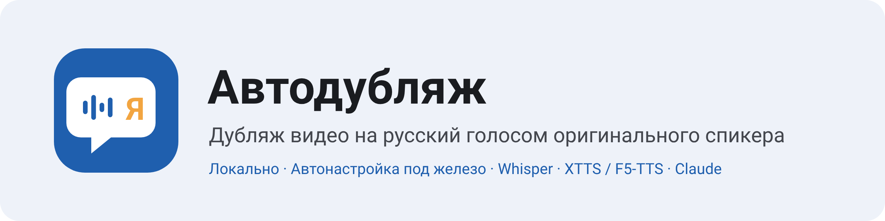
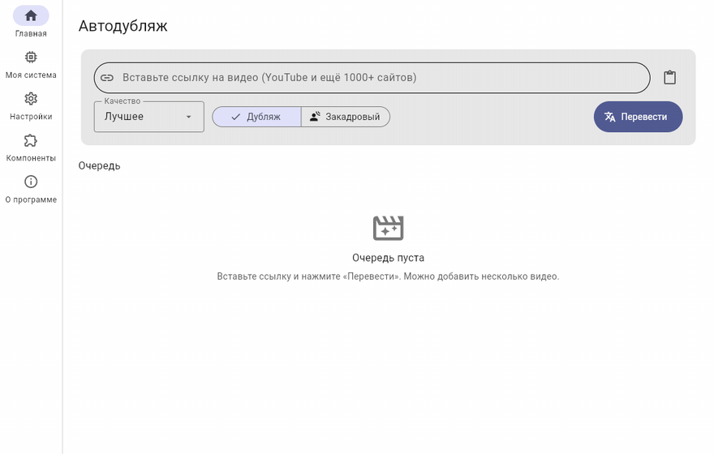
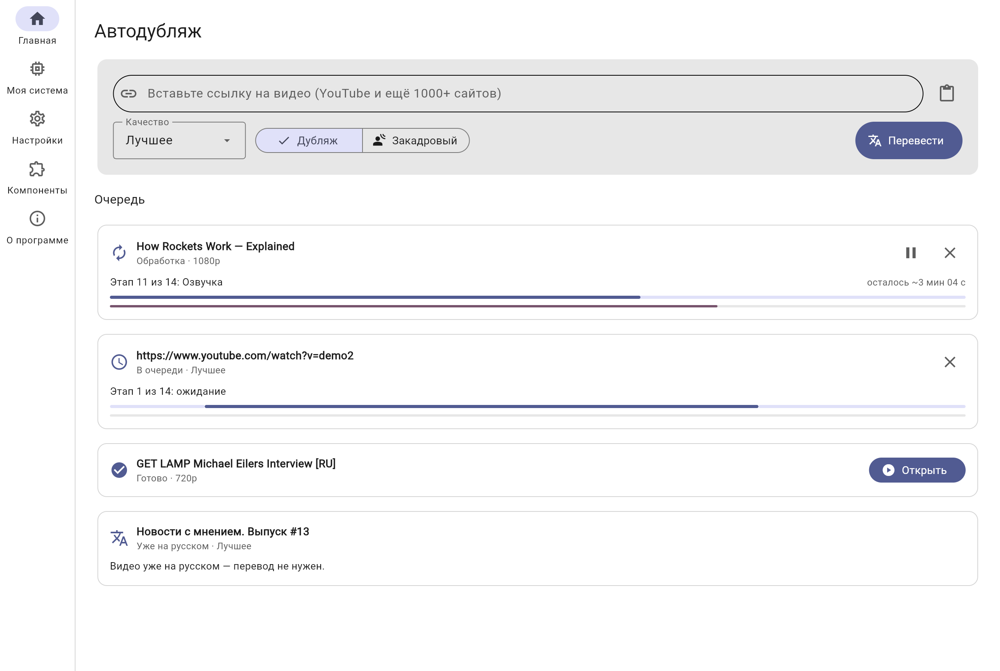
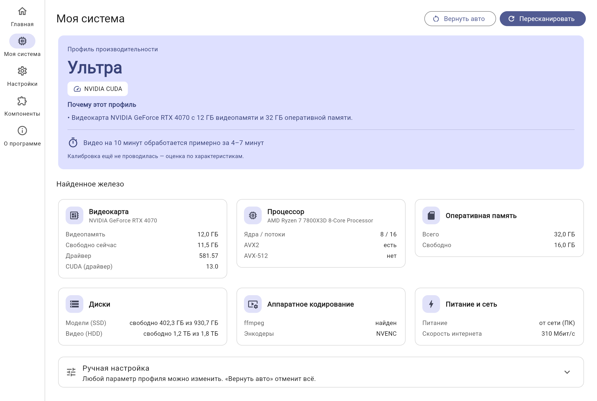
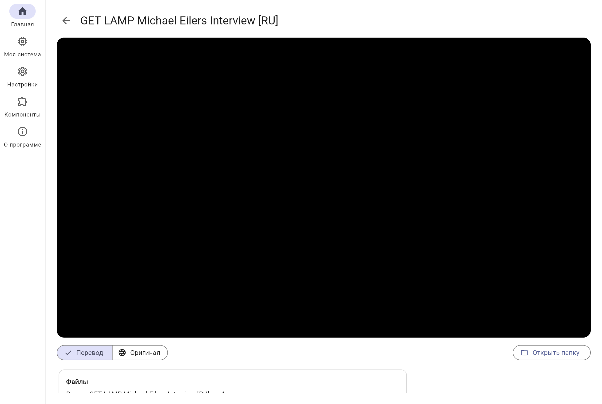
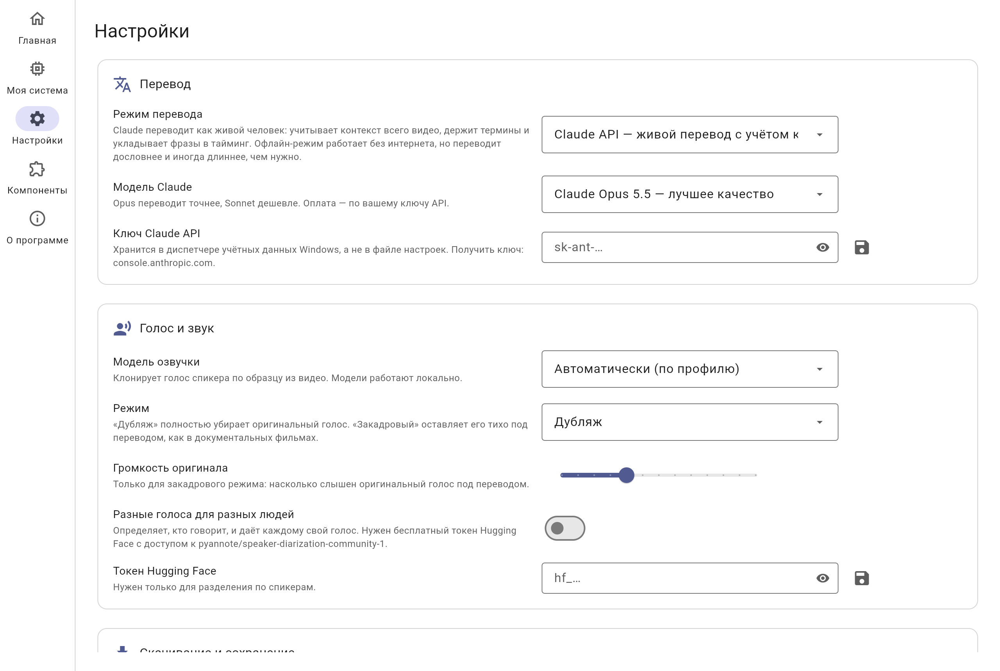
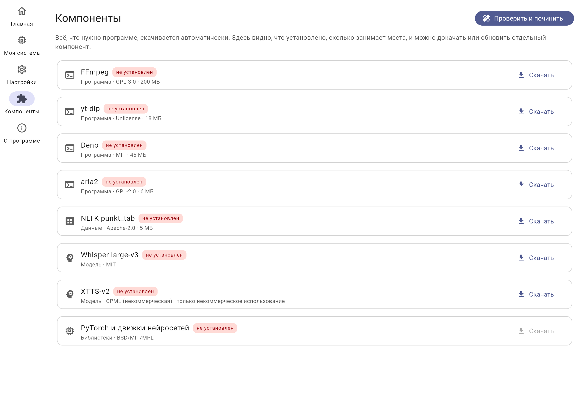
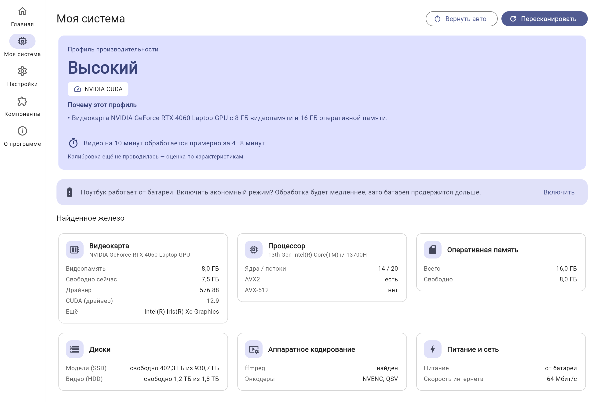
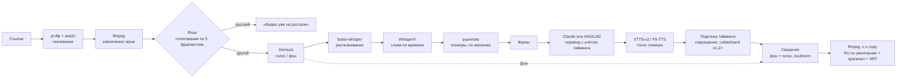

<p align="right"><b>Русский</b> · <a href="README.en.md">English</a></p>

<p align="center">
  
</p>

<p align="center">
  <a href="https://github.com/Zaxar1231/Yutr/releases/latest"></a>
  <a href="https://github.com/Zaxar1231/Yutr/releases"></a>
  <a href="https://github.com/Zaxar1231/Yutr/actions/workflows/ci.yml"></a>
  <a href="LICENSE"></a>
  
  
</p>

<p align="center"><b>Вставьте ссылку на видео — получите его на русском, голосом оригинального спикера.</b><br>
Всё работает у вас на компьютере и само подстраивается под ваше железо.</p>

<p align="center">
  
</p>

<p align="center">
  <a href="https://github.com/Zaxar1231/Yutr/releases/latest"></a>
</p>

## Возможности

- **Голос похож на оригинал.** Модель клонирует тембр по чистому фрагменту речи из самого видео, а интонацию каждой фразы берёт из оригинальной фразы.
- **Живой перевод.** Claude видит всё видео целиком, держит термины и стиль спикера и укладывает фразу в её длительность. Есть офлайн-режим без интернета (MADLAD-400).
- **Фон остаётся оригинальным.** Голос отделяется от музыки и звуков (Demucs), а новая речь накладывается на настоящий фон.
- **Без «бурундуков» и наложений.** Длинную фразу сначала сокращает переводчик, потом она ускоряется максимум до 1,2×, фразы никогда не перекрываются.
- **Русское не переводится.** Язык определяется по нескольким фрагментам. Если видео уже на русском, вы увидите «Видео уже на русском». В смешанных видео русские куски остаются как есть.
- **Дубляж или закадровый перевод.** Во втором режиме оригинал тихо слышен под переводом, громкость настраивается.
- **Два языка в одном файле.** Видео копируется без перекодирования: русская дорожка идёт по умолчанию, оригинал вторым, плюс субтитры .srt на обоих языках.
- **Быстрое скачивание.** yt-dlp с aria2c и параллельными фрагментами, качество на выбор (лучшее, 1080p, 720p, только аудио), плейлисты, cookies из браузера для закрытых видео.
- **Сам настраивается под ПК.** Находит видеокарту, процессор, память, диски и энкодеры, выбирает один из пяти профилей и уточняет его коротким тестом.
- **Не падает.** Перед загрузкой модели проверяет свободную память. Если её всё же не хватило, повторяет этап на профиль ниже. Без видеокарты работает на процессоре и честно предупреждает, что это займёт долго.
- **Очередь с паузой и продолжением.** Каждый этап кэшируется, так что после сбоя или отмены задача продолжается с того же места.
- **Сам ставит всё нужное и сам обновляется** из GitHub, с откатом, если новая версия не запустилась.

## Скриншоты

<table>
<tr>
<td><b>Главная и очередь</b><br><picture><source media="(prefers-color-scheme: dark)" srcset="docs/assets/screenshots/home-rtx4070-dark.png"></picture></td>
<td><b>Моя система</b><br><picture><source media="(prefers-color-scheme: dark)" srcset="docs/assets/screenshots/system-rtx4070-dark.png"></picture></td>
</tr>
<tr>
<td><b>Результат</b><br><picture><source media="(prefers-color-scheme: dark)" srcset="docs/assets/screenshots/result-rtx4070-dark.png"></picture></td>
<td><b>Настройки</b><br><picture><source media="(prefers-color-scheme: dark)" srcset="docs/assets/screenshots/settings-rtx4070-dark.png"></picture></td>
</tr>
<tr>
<td><b>Компоненты</b><br><picture><source media="(prefers-color-scheme: dark)" srcset="docs/assets/screenshots/components-rtx4070-dark.png"></picture></td>
<td><b>Ноутбук на батарее</b><br><picture><source media="(prefers-color-scheme: dark)" srcset="docs/assets/screenshots/system-laptop-dark.png"></picture></td>
</tr>
</table>

Скриншоты обновляются командой `uv run python scripts/screenshots.py`. Тема переключается вместе с темой GitHub.

Тестовая речь для калибровки — отрывок аудиокниги «Maybe—Tomorrow» из [LibriVox](https://librivox.org) (общественное достояние).

**До и после:** фрагмент [оригинала](docs/assets/demo/before.mp4) и [дубляжа](docs/assets/demo/after.mp4) интервью из документального фильма GET LAMP (CC BY-SA 3.0, см. [docs/assets/demo](docs/assets/demo/README.md)).

## Системные требования

| | Минимум | Рекомендуется |
|---|---|---|
| ОС | Windows 10 1809 (x64) | Windows 11 |
| Видеокарта | не обязательна (работает на процессоре) | NVIDIA с 8+ ГБ видеопамяти, драйвер 527+ |
| Оперативная память | 8 ГБ | 16–32 ГБ |
| Диск | 10 ГБ свободно (лучше SSD) | 25 ГБ на SSD |
| Интернет | для скачивания видео и первой установки | для перевода через Claude |

Видеокарты AMD RX 7000/9000 на Windows 11 работают через ROCm (экспериментально). Остальные AMD и Intel ускоряют только разделение звука через DirectML, всё прочее идёт на процессоре.

### Профили производительности

Профиль выбирается автоматически по видеопамяти и памяти, затем уточняется 30-секундной калибровкой. Любой параметр можно поменять вручную в «Моя система».

| Профиль | Видеопамять | Whisper | Разделение (Demucs) | Модели в памяти | 10 мин видео* |
|---|---|---|---|---|---|
| Ультра | 12+ ГБ | large-v3, float16, batch 16 | htdemucs_ft, 2 прохода | держит одновременно | ~4–7 мин |
| Высокий | 8–12 ГБ | large-v3-turbo, float16, batch 8 | htdemucs_ft | по очереди | ~4–8 мин |
| Средний | 6–8 ГБ | large-v3-turbo, int8_float16, batch 4 | htdemucs, сегмент 7 с | по очереди | ~6–11 мин |
| Низкий | 4–6 ГБ | medium, int8_float16 | htdemucs, сегмент 4 с | по очереди | ~9–17 мин |
| Только процессор | — | small/medium, int8 | htdemucs на CPU | по очереди | ~45–90 мин |

\* Оценка до калибровки. После неё программа показывает время именно для вашего ПК. Потоки yt-dlp подбираются по замеру скорости интернета, видеоэнкодер (NVENC, QSV, AMF) — по тому, что реально работает на вашей системе.

## Установка

1. Скачайте `Autodub-Setup-x.y.z.exe` со [страницы релизов](https://github.com/Zaxar1231/Yutr/releases/latest).
2. Запустите его. Права администратора не нужны: программа ставится в вашу папку пользователя. Галочка «Портативный режим» хранит всё в папке программы.
3. Откройте «Автодубляж». Мастер первого запуска сам определит железо, покажет, что и какого размера будет скачано, и всё установит.

### Первый запуск

Мастер ставит собственный Python (системный не нужен и не трогается), PyTorch под вашу видеокарту, ffmpeg, yt-dlp, Deno, aria2c и только те модели, которые нужны вашему профилю. Загрузки докачиваются при обрыве и проверяются по SHA-256. Если HF недоступен, модели берутся с зеркала hf-mirror. В конце идёт калибровка (~30 с).

Для перевода через Claude добавьте ключ API в «Настройки → Перевод». Он хранится в диспетчере учётных данных Windows. Без ключа включите офлайн-перевод.

## Частые вопросы

<details><summary><b>Windows пишет «Система Windows защитила ваш компьютер» (SmartScreen)</b></summary>

Установщик пока не подписан платным сертификатом, поэтому SmartScreen его не знает. Нажмите **«Подробнее» → «Выполнить в любом случае»**. Контрольную сумму файла можно сверить с `checksums.txt` в релизе:
`Get-FileHash .\Autodub-Setup-*.exe -Algorithm SHA256`.
</details>

<details><summary><b>У меня нет видеокарты NVIDIA</b></summary>

Программа всё равно работает: на процессоре или с частичным ускорением на AMD и Intel. Обработка будет дольше, примерное время показано в «Моя система».
</details>

<details><summary><b>«Не хватает видеопамяти»</b></summary>

Программа сама повторит этап на профиль ниже и сообщит об этом. Чтобы так не случалось, закройте игры и браузер с видео или выберите профиль ниже в «Моя система».
</details>

<details><summary><b>Видео с YouTube не скачивается: «войдите в аккаунт»</b></summary>

Включите «Cookies из браузера» в настройках и выберите браузер, в котором вы вошли на YouTube. Браузер лучше закрыть на время скачивания.
</details>

<details><summary><b>Где лежат файлы и как всё удалить</b></summary>

Программа: `%LOCALAPPDATA%\Programs\Autodub`. Модели, настройки и кэш: `%LOCALAPPDATA%\Autodub`. Готовые видео сохраняются в «Видео\Автодубляж». Деинсталлятор спросит, удалять ли модели.
</details>

<details><summary><b>Голос звучит не очень похоже</b></summary>

Похожесть зависит от чистоты речи в оригинале: музыка поверх голоса и эхо мешают. Попробуйте другую модель озвучки в настройках. F5-TTS обычно точнее передаёт интонацию, XTTS-v2 стабильнее.
</details>

## Как это работает



Каждый этап — отдельный модуль. Тяжёлые модели работают в отдельном процессе, поэтому интерфейс не зависает, а сбой модели не роняет программу. Модель меняется одной строкой в настройках. Результат каждого этапа кэшируется.

## Сборка из исходников

```bash
git clone https://github.com/Zaxar1231/Yutr && cd Yutr
uv sync
uv run pytest
uv run autodub system                      # железо и профиль
uv run python -m autodub.app.main          # интерфейс
uv run autodub dub "https://…" --translator madlad --out ./out   # CLI
uv run python scripts/build_release.py     # архив обновления и папка для установщика
iscc installer\autodub.iss                 # установщик (Windows, Inno Setup 6)
```

Подробнее о правилах — в [CONTRIBUTING.md](CONTRIBUTING.md). Выбор архитектуры и моделей описан в [docs/PROPOSAL.md](docs/PROPOSAL.md).

## Благодарности

| Проект | Для чего | Лицензия |
|---|---|---|
| [yt-dlp](https://github.com/yt-dlp/yt-dlp) | скачивание | Unlicense |
| [FFmpeg](https://ffmpeg.org) ([сборки BtbN](https://github.com/BtbN/FFmpeg-Builds)) | звук и видео | GPL-3.0 |
| [aria2](https://github.com/aria2/aria2) | многопоточная загрузка | GPL-2.0 |
| [Deno](https://deno.com) | JS-движок для yt-dlp | MIT |
| [faster-whisper](https://github.com/SYSTRAN/faster-whisper) / [CTranslate2](https://github.com/OpenNMT/CTranslate2) | распознавание | MIT |
| [WhisperX](https://github.com/m-bain/whisperX) | выравнивание слов | BSD-2-Clause |
| [Demucs](https://github.com/adefossez/demucs) | отделение голоса | MIT |
| [pyannote.audio](https://github.com/pyannote/pyannote-audio) | спикеры | MIT |
| [coqui-tts](https://github.com/idiap/coqui-ai-TTS) (XTTS-v2) | озвучка | MPL-2.0 |
| [F5-TTS](https://github.com/SWivid/F5-TTS) | озвучка | MIT |
| [MADLAD-400](https://huggingface.co/google/madlad400-3b-mt) | офлайн-перевод | Apache-2.0 |
| [Flet](https://flet.dev) | интерфейс Material 3 | Apache-2.0 |
| [uv](https://github.com/astral-sh/uv) | Python и зависимости | MIT / Apache-2.0 |
| [Inno Setup](https://jrsoftware.org/isinfo.php) | установщик | Inno Setup License |

## Лицензии моделей

Код программы распространяется по лицензии MIT. Веса моделей — отдельно, у каждой своя лицензия:

| Модель | Лицензия | Коммерческое использование |
|---|---|---|
| Whisper (faster-whisper) | MIT | можно |
| Demucs htdemucs | MIT | можно |
| wav2vec2 (выравнивание) | Apache-2.0 | можно |
| pyannote speaker-diarization-community-1 | CC-BY-4.0 | можно, с указанием авторства |
| MADLAD-400 | Apache-2.0 | можно |
| **XTTS-v2** | **Coqui Public Model License** | **нет, только некоммерческое** |
| **F5-TTS RUSSIAN** (Misha24-10) | **CC-BY-NC-4.0** | **нет, только некоммерческое** |

Перед скачиванием моделей озвучки программа просит подтвердить, что вы используете их некоммерчески.

**Почему MIT.** Всё, что программа импортирует, совместимо с MIT: MIT, BSD, Apache-2.0, MPL-2.0 (copyleft на уровне файлов, только если менять файлы самой библиотеки). GPL-программы ffmpeg и aria2 запускаются как отдельные процессы и скачиваются при первом запуске, программа с ними не линкуется.

## Ответственное использование

Клонирование голоса — только для личного использования и с уважением к правам авторов. Не публикуйте чужие видео в дубляже без разрешения правообладателя. Не выдавайте синтезированную речь за слова реального человека. Не используйте программу для обмана.
